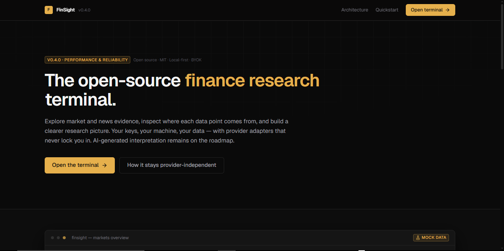
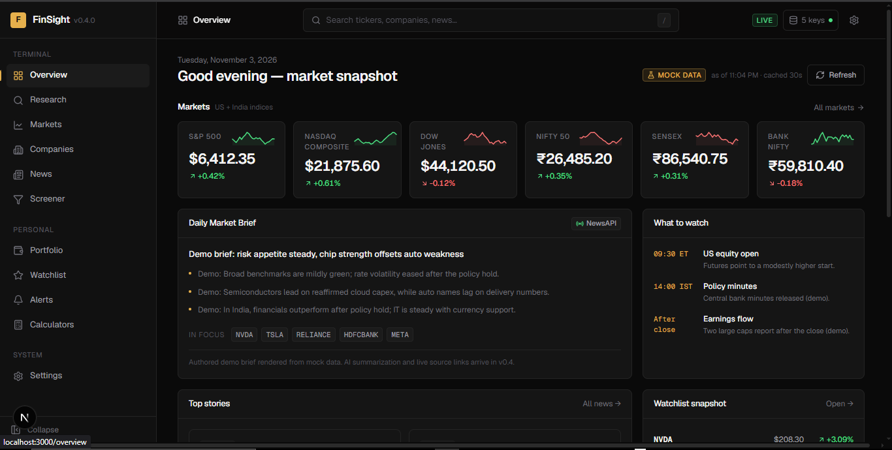

# FinSight

**An open-source, local-first, BYOK finance research terminal.**

[](https://github.com/ks2483735-afk/finsight/releases) [](https://github.com/ks2483735-afk/finsight/blob/main/LICENSE)

**Latest stable release:** [v0.3.0 — Performance & Reliability](https://github.com/ks2483735-afk/finsight/releases/tag/v0.3.0)

**Next release candidate:** [v0.4.0 — Performance & Reliability](https://github.com/ks2483735-afk/finsight/pull/8)

**Live web app:** [https://finsight-psi-gold.vercel.app](https://finsight-psi-gold.vercel.app)

> **Mobile support:** FinSight is currently designed primarily for desktop screens and is **not yet optimized for mobile devices**. Some pages and controls may be difficult to use on smaller screens.

FinSight is an open-source finance research terminal for exploring market data, news, and company context. Live quotes and headlines use configured providers where supported; unsupported data remains clearly labeled as demo data. AI-generated financial interpretation is still in development.

> **Release candidate: v0.4.0 — Performance & Reliability.** This update focuses on faster provider routing, fewer unnecessary upstream calls, concurrent supported requests, shorter provider timeouts, zero artificial delays in local mock fallbacks, and static delivery of the landing page. It does not add AI answers or make the broad demo market universe live. The current stable release remains v0.3.0 until v0.4.0 is published.

---

## 📸 FinSight in action

### Landing page



### Overview dashboard



---

## Performance notes

FinSight prioritizes honest data and predictable provider behavior over pretending every screen is live. The current adapters do not provide a single bulk endpoint for the entire demo universe, so the broad market table and movers remain mock/demo data. Individual company quote lookups and supported indices can use configured live providers. See the v0.4.0 release-candidate notes below.

## What works today (v0.4.0 release candidate)

| Area | State |
| --- | --- |
| Landing page + terminal shell (sidebar, header, global search) | ✅ |
| Dark financial-terminal design system (tokens, components, states) | ✅ |
| Overview dashboard (indices, brief, stories, focus, watchlist, movers) | ✅ |
| Research pipeline UI (steps → evidence → observations → AI status) | ✅ |
| Markets / Companies / News / Screener pages | ✅ |
| Watchlist, Portfolio, Alerts — CRUD backed by local SQLite | ✅ |
| Calculators (SIP, Lumpsum, CAGR, Compound, EMI, Dividend) | ✅ deterministic |
| BYOK Settings (store keys, enable/disable, honest connection tests) | ✅ |
| Provider architecture (interfaces, registry, fallback chain, TTL cache and request deduplication) | ✅ |
| Finnhub live market-data adapter | ✅ |
| Alpha Vantage live market-data adapter | ✅ |
| Public RSS news adapter (no API key required) | ✅ |
| NewsAPI adapter | ✅ available; requires a NewsAPI key |
| Google Gemini adapter | ⏳ Planned — not implemented |
| AI answers / citations | ⏳ Planned — not implemented |
| Earnings/events and SEC/MCA filings ingestion | ⏳ v0.5 |
| Alert evaluation & notifications | ⏳ v0.7 |

## Pinokio

FinSight includes a Pinokio launcher for one-click local installation and startup. Pinokio can install the Node dependencies, launch the local Next.js server, open the Web UI, update dependencies, and reset generated build artifacts. The launcher does not include or request any API keys; FinSight remains BYOK.

After cloning the repository into Pinokio, use **Install** and then **Start**. Pinokio apps can also be installed directly from a public GitHub repository URL; verified apps are separately listed in Pinokio's Discover catalog.

## Quickstart

### Standard Node.js setup

Requirements: Node.js with npm and Git.

```bash
git clone https://github.com/ks2483735-afk/finsight.git
cd finsight
npm install
npm run dev
```

Then open the local URL printed by Next.js (normally `http://localhost:3000`).

Zero-key mode works out of the box. FinSight can run without provider API keys and clearly labels demo/mock data when a live provider is unavailable.

### Optional — bring your own keys (BYOK)

Copy the environment template and fill in only the providers you want to use:

```bash
# macOS/Linux
cp .env.example .env.local
```

On Windows PowerShell:

```powershell
Copy-Item .env.example .env.local
```

Keys can also be added later at **Settings → Providers**. They are stored server-side in the local SQLite database and are never exposed to browser code.

## Supported providers (BYOK)

| Provider | Kind | Adapter | Status |
| --- | --- | --- | --- |
| Google Gemini | AI | descriptor only | ⏳ planned |
| AIMLAPI | AI | descriptor only | ⏳ planned |
| BazaarLink | AI | descriptor only | ⏳ planned |
| Alpha Vantage | Market data | live | ✅ v0.2 |
| Finnhub | Market data | live | ✅ v0.2 |
| NewsAPI | News | live | ✅ available with key |
| Public RSS feeds | News | live | ✅ no key required |
| FinSight mock adapter | Market data + news | mock/demo | ✅ fallback mode |

**Connection tests are honest.** If a provider has no configured key, FinSight reports that no request was sent. For implemented live adapters, the test makes a real provider request and reports the provider's response or error.

## Architecture

```
UI (Next.js)
   │  fetch /api/*
   ▼
FinSight services            lib/market-data, lib/news, lib/ai (router), lib/screener
   │  provider registry lookup + TTL cache + fallback chain
   ▼
Provider adapters            providers/<vendor>  (MarketDataProvider / AIProvider / NewsProvider)
   │
   ▼
Normalized objects           Quote { symbol, price, currency, change, changePercent,
                                    timestamp, source, isMock }
```

Design rules enforced in code:

- The frontend **never** imports a concrete provider — only services and types.
- Every payload carries a `DataSourceInfo { providerId, label, isMock, degraded }`, which the UI renders as a `MOCK DATA` or provider badge.
- Fallback chain: preferred live provider → next live provider → demo data → clear "unavailable" message. Never a fabricated result.
- AI results are gated on `descriptor.adapterImplemented` — until the AI adapter ships, FinSight reports that it is unavailable instead of inventing answers.

## Configuration

| Variable | Purpose | Default |
| --- | --- | --- |
| `FINSIGHT_DB_PATH` | Local SQLite database path | `./data/finsight.db` |
| `GEMINI_API_KEY` | Planned AI integration | — |
| `AIMLAPI_API_KEY` / `AIMLAPI_BASE_URL` | Planned AI integration | — |
| `BAZAARLINK_API_KEY` / `BAZAARLINK_BASE_URL` | Planned AI integration | — |
| `ALPHA_VANTAGE_API_KEY` | Live market data | — |
| `FINNHUB_API_KEY` | Live market data | — |
| `NEWSAPI_API_KEY` | NewsAPI | — |

All keys are optional. Never commit real keys (`.env.local` is git-ignored).

## Project structure

```
finsight/
├── app/
│   ├── page.tsx                 # landing
│   ├── (terminal)/              # sidebar + header shell
│   │   ├── overview/ research/ markets/ companies/ news/
│   │   ├── screener/ portfolio/ watchlist/ alerts/
│   │   └── calculators/ settings/
│   └── api/                     # route handlers → services (never providers)
├── components/
│   ├── ui/                      # Button, Input, Card, Badge, Tabs, Modal, Dropdown,
│   │                            # Tooltip, Skeleton, DataTable, states…
│   ├── layout/                  # Shell, Sidebar, Header, GlobalSearch, PageHeader
│   └── finance/                 # MetricCard, ChartCard, Sparkline, LineChart,
│                                # StockCard, NewsCard, SourceBadge, ChangeValue
├── lib/
│   ├── market-data/             # types + service (fallback chain)
│   ├── news/  ├── ai/           # news service; AI router + research orchestration
│   ├── screener/ ├── finance/   # NL parser + filter runner; calculators
│   ├── providers/               # registry, key config, connection tests
│   ├── database/                # sqlite, schema, repositories (watchlist…)
│   ├── cache/  ├── hooks/  ├── mock/   # TTL cache, data hooks, demo universe
│   └── nav.ts format.ts api.ts utils.ts
├── providers/                   # adapters: mock/, gemini/, aimlapi/, bazaarlink/,
│                                # alphavantage/, finnhub/, newsapi/, rss/
├── .env.example                 # environment variable template
├── .gitignore  README.md  LICENSE
└── package.json
```

## v0.4.0 performance updates

The v0.4.0 release candidate includes:

- The broad Markets universe and movers stay explicitly demo-backed instead of triggering unsupported per-symbol bulk requests against quota-limited providers.
- Individual quote lookups can combine successful provider coverage, so one provider's unsupported symbols do not discard quotes returned by another.
- Finnhub quote requests use bounded concurrency, and supported index requests run concurrently.
- Alpha Vantage requests are processed in small batches to reduce latency without creating an uncontrolled request burst.
- Disabled or unconfigured live providers are skipped before requests are made.
- Configured NewsAPI is preferred; public RSS remains the no-key fallback.
- External provider requests use bounded timeouts, and local mock market/news data no longer adds artificial waiting time.
- The landing page is statically prerendered; its clearly labeled simulated market preview updates in the browser.

### Release-candidate verification

- The performance branch's Vercel preview build completed successfully with TypeScript validation and all 16 static pages generated.
- The landing route was reported as static in the build output.
- Run `npm run typecheck`, `npm run build`, and `npm run smoke` locally against the final release-candidate commit before publishing the release.
- No before/after runtime benchmark has been recorded yet, so this release does not claim a specific percentage or millisecond speed improvement.
- No API keys are committed to the repository.

Live-provider behavior still depends on your own provider keys, quotas, and network availability.

See [CHANGELOG.md](CHANGELOG.md) for the release-by-release change log.

## Verification

```bash
npm run typecheck        # tsc --noEmit
npm run smoke            # headless-browser UI sweep (Playwright, dev-only)
npm run build            # production build check
```

The smoke suite loads routes, checks key UI states, search/research navigation, SQLite CRUD round-trips, calculator math, BYOK save/test/clear flows, and responsive viewports.

## UI states

Every data-driven view handles **loading** (skeletons), **loaded**, **empty** (with an action), **error** (with retry), **no API key**, **provider unavailable**, and **mock data** labeling.

## Security

- API keys live in the local SQLite `settings` table (server-side only) or environment variables. API routes return `configured: true/false` — never key values.
- `.env.local` is git-ignored; only the placeholder template is committed.
- Rotate a key by revoking it at the provider, then updating it in Settings.
- The Settings → Data page can wipe all local data (records and stored keys).
- **Never commit real API keys to GitHub.**

## Public deployment limitation

FinSight is currently a **local-first, single-user app**. It does not yet provide authentication or per-user database isolation. For safety, the production middleware disables the personal-data APIs on non-local hosts: watchlists, portfolios, alerts, and provider settings return HTTP 503 on a public deployment. Public market/news/research demo routes remain available.

Run FinSight on your own computer to use personal data and save provider keys. Do not deploy this version as a multi-user service or store personal financial data on a shared host. Proper hosted support requires authentication, per-user data isolation, and a suitable persistent database before those APIs can be enabled publicly.

## Roadmap

- **v0.5** — Gemini AI integration, financial interpretation, and sourced answers
- **v0.6** — Expanded news intelligence, clustering, and richer daily briefs
- **v0.7** — Earnings, company events, and SEC/MCA filings
- **v0.8** — Alert evaluation and notifications

## Contributing

Issues and PRs are welcome. Good areas include additional live provider adapters, calculators, charts, and research features. Please keep the two hard rules:

1. The UI talks to **services**, never to a provider directly.
2. Anything that is not live data must be **explicitly labeled as mock/demo**.

## License

[MIT](LICENSE) — free to use, fork, and self-host. BYOK: you pay providers directly for your own usage.
